<div align="center">


# Stetho

### A stethoscope for machines.

**Hold your phone near a fan, motor or pump. In 10 seconds it tells you what's wrong, and why.**

[](ml/)
[](ml/stetho/model.py)
[](web/src/ml/ae.js)
[](web/src/App.jsx)
[](web/src/components/Waterfall.jsx)
[](web/vite.config.js)
[](LICENSE)

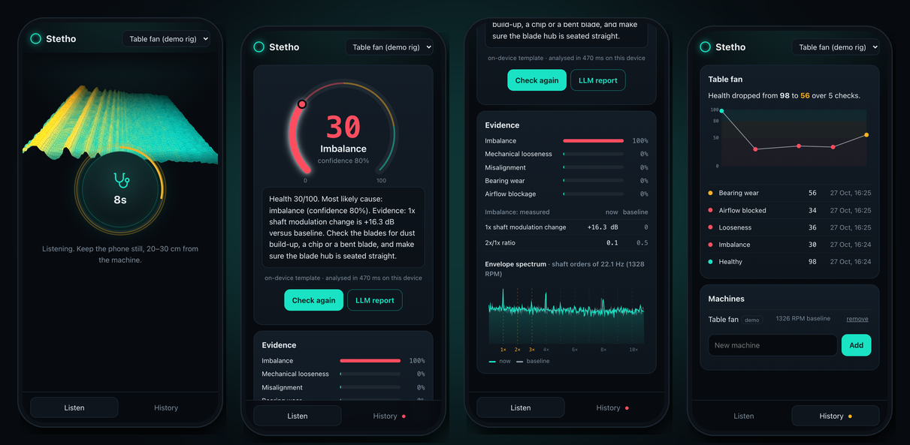

</div>

---

## Why this exists

Mechanics diagnose machines by **listening**. A worn bearing whines, an unbalanced fan wobbles, a loose mount rattles. In industry this is called *predictive maintenance*: unplanned downtime is often quoted at tens of thousands of dollars an hour on a production line, and most failures announce themselves acoustically long before they become catastrophic.

Stetho turns a phone's microphone into that trained ear:

1. **Record a healthy baseline.** Stetho learns how *this* machine sounds when it is fine: its shaft speed, blade count and spectral fingerprint.
2. **Check it any time.** Ten seconds of audio becomes a log-mel spectrogram, an autoencoder anomaly score, and an order-domain vibration analysis.
3. **Get a diagnosis you can verify.** You get a 0–100 health score, the most likely fault, a confidence, the *measured evidence* (which shaft orders changed, and by how many dB), and a plain-English report that is only allowed to cite those numbers.

Everything runs **on the device**, including the neural network. Audio never leaves the phone, which matters on a factory floor with no Wi-Fi or strict data rules.

> [!NOTE]
> **What's real and what's simulated.** The anomaly detector is benchmarked on **real industrial recordings** (MIMII / DCASE 2020 Task 2). The fault *classification* (imbalance vs. looseness vs. …) is evaluated on a **physics-based fan simulator** that I wrote. Collecting a labelled real-rig dataset with a table fan is the next milestone (see [Roadmap](#roadmap)). Every number below says which of the two it comes from.

## Results at a glance

| | |
|---|---|
| 🏭 **Real-machine anomaly detection** (MIMII / DCASE 2020, 16 machine IDs) | **AUC 75.3** vs. 72.4 for the official baseline, with 4.5× less training data |
| 🔧 **Fault diagnosis** (6 classes, 12 unseen simulated fans) | **86.1% accuracy**, 4.2% false alarms |
| ⚡ **On-device latency** (browser, recording → verdict) | **446 ms**, 1.07 MB model, works offline |
| 🔁 **Python ↔ browser parity** | log-mel within 0.01 dB, every physics measure within 0.1% |

---

## How it works

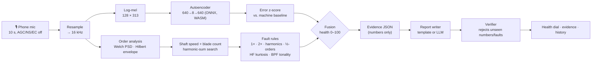

### 1 · Front end: what the network hears

The DCASE 2020 Task 2 recipe, re-implemented twice (Python for training, JavaScript for the phone) and **unit-tested to agree within 0.01 dB**:

$$X_{t,m} = 10\log_{10}\Big(\sum_k M_{m,k}\,\big|\mathrm{STFT}_{1024,\,512}\{x\}_{t,k}\big|^2 + \epsilon\Big),\qquad m = 1..128$$

Five consecutive frames are stacked into a 640-d vector, which gives 309 vectors per 10-second clip.

### 2 · Autoencoder: "does this still sound like itself?"

A dense autoencoder, `640 → 128×4 → 8 → 128×4 → 640` with BatchNorm and ReLU (266k parameters, **1.07 MB ONNX**). It is trained only on healthy sound, because real fault recordings are rare. The anomaly score is the reconstruction error:

$$e_t = \tfrac{1}{640}\lVert \tilde{x}_t - \mathrm{AE}(\tilde{x}_t)\rVert_2^2,\qquad \tilde{x} = (x-\mu)/\sigma$$

The network is generic ("healthy rotating machine"). It is trained on 1,016 clips: real MIMII fans plus simulated table and PC fans. It is personalised **without retraining**: the baseline recording gives a robust per-machine reference (median and MAD over 1-second windows), and each check is expressed as a z-score against it:

$$z = \frac{\bar e - \operatorname{median}(\bar e^{\,\text{base}}_{w})}{\max\!\big(1.4826\cdot\mathrm{MAD},\ 0.08\,\operatorname{median}\big)},\qquad H_{AE} = \frac{100}{1+e^{(z-6)/1.6}}$$

### 3 · Physics layer: the mechanical edge

An autoencoder can say *something changed*. It cannot say *what*. That is the job of classical vibration analysis, adapted to a microphone.

**The problem.** A table fan turns at about 20 Hz (1200 RPM). Phone microphones roll off below about 100 Hz, so the shaft frequency 1×, where imbalance lives, is barely recorded.

**The trick: envelope analysis.** Rotating defects *modulate* the loud aerodynamic and blade-pass sound at the shaft rate. Demodulating a band with the analytic signal and taking the spectrum of its envelope recovers 1×, 2× and the bearing frequencies even when the raw spectrum is useless there:

$$\mathcal{E}(f) = \frac{2}{\sum w}\,\frac{\big|\mathcal{F}\{ w\cdot(|x_a| - \overline{|x_a|})\}(f)\big|}{\overline{|x_a|}},\qquad x_a = \mathcal{F}^{-1}\{2\,\mathbb{1}_{[300,3000]}(f)\,X(f)\}$$

$\mathcal{E}(h f_1)$ is literally the *modulation depth* at shaft order $h$, a dimensionless number that is robust to phone gain.

<p align="center">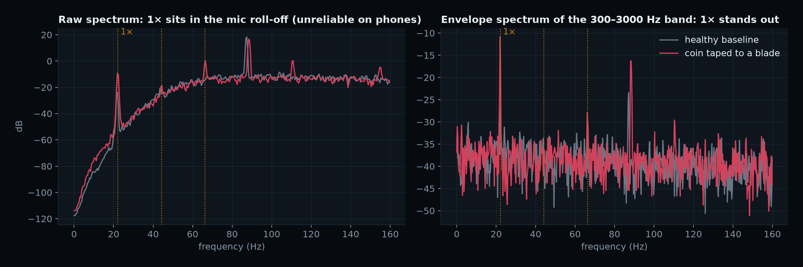</p>

**Finding the shaft speed from sound alone.** A harmonic-sum search over the shaft frequency $f_1 \in [8, 50]$ Hz and the blade count $B \in \{3,4,5,7,9\}$:

$$S(f_1,B) = \sum_{k=1}^{4}\mathrm{PNR}_{\text{psd}}(kBf_1) + \tfrac12\!\!\sum_{d=\pm1}\!\mathrm{PNR}_{\text{psd}}(Bf_1+df_1) + 2\!\!\sum_{\substack{h=1..3\\ B\nmid h}}\!\mathrm{PNR}_{\text{env}}(hf_1) - 1.5\!\!\sum_{k\in\{1,3\}}\!\mathrm{PNR}_{\text{psd}}\!\big(\tfrac{k}{2}Bf_1\big)$$

The terms are blade-pass harmonics, shaft-rate sidebands, envelope orders, and an octave guard that kills the classic "4 blades at 21 Hz vs. 2 blades at 42 Hz" ambiguity. After the baseline, $B$ is locked and $f_1$ is tracked within ±8%, so a strong 2× fault cannot hijack the speed estimate.

**Rule engine.** Each rule compares the new recording against the machine's own baseline and outputs a severity in [0, 1]:

| Fault | Physical signature | Rule (Δ = change vs. baseline) |
|---|---|---|
| **Imbalance** | once-per-rev force → pure **1×** | Δ1× modulation 4 → 12 dB, suppressed if 2×/1× > 0.8 or the harmonic comb also grew |
| **Misalignment** | twice-per-rev → **2×** (and 3×) | Δ2× 4 → 12 dB **and** 2×/1× > 0.5 |
| **Looseness** | rattle → **harmonic comb** 4×–10× plus **½-orders** (part lifts every other turn) | Δharmonic RMS 2 → 7 dB, boosted by Δ½-orders |
| **Bearing wear** | impacts at **BPFO ≈ 3.57×** exciting a 3–6 kHz resonance | Δ(2.5–7.5 kHz energy) 3 → 10 dB, or Δkurtosis 1 → 6, or a *non-synchronous* envelope peak |
| **Airflow blockage** | rotating stall: blade-pass tone **drowns in turbulence**, speed shifts | Δ BPF tonality −4 → −10 dB, boosted by noise-floor rise or a speed change of 2.5% or more |

<p align="center">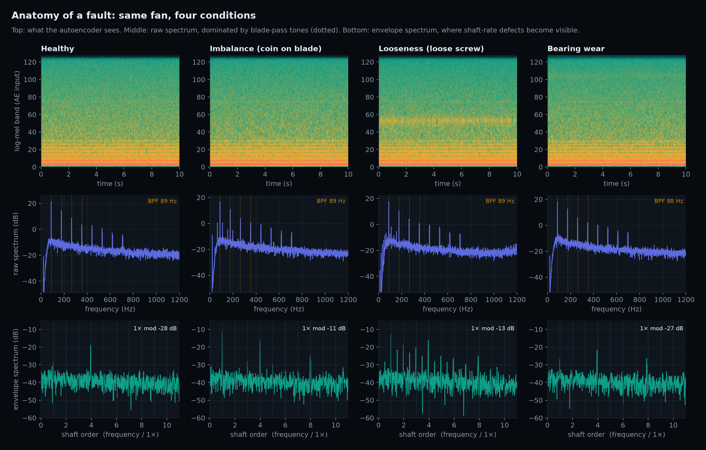</p>

### 4 · Fusion → one number

$$H = \min\big(H_{AE},\ 100 - 70\cdot\max_r \mathrm{sev}_r\big)$$

A fired rule can only pull health *down*. A fault is *named* when its rule reaches 0.5 severity. If the autoencoder is alarmed (H < 65) but no rule fires, the verdict is the honest **"abnormal sound, unclassified"**. Bands: 🟢 ≥ 80 · 🟡 50–80 · 🔴 < 50.

### 5 · A report that can't make things up

The report writer never sees audio or the model. It only sees an evidence object like this one:

```json
{ "machine": "Table fan", "health": 30, "label": "imbalance", "confidence_pct": 80, "rpm": 1328,
  "fired": ["imbalance"],
  "top_rule": { "id": "imbalance", "evidence": [
      { "name": "1x shaft modulation change", "now": 16.3, "baseline": 0, "unit": "dB" },
      { "name": "2x/1x ratio", "now": 0.1, "baseline": 0.5, "unit": "ratio" } ] } }
```

> *Health 30/100. Most likely cause: imbalance (confidence 80%). Evidence: 1x shaft modulation change is +16.3 dB versus baseline. Check the blades for dust build-up, a chip or a bent blade, and make sure the blade hub is seated straight.*

By default a deterministic on-device template writes it, so it works offline. Optionally, an LLM rewrites it through a serverless proxy (`web/api/report.js`, any OpenAI-compatible endpoint). The proxy sends only those numbers. Either way the output passes through a **verifier** ([`report.js`](web/src/dsp/report.js), [tests](web/tests/report.test.js)). The verifier extracts every number and fault term and rejects the text if any of them is not in the evidence. A rejected LLM report falls back to the template.

---

## Results

### A · Public benchmark: MIMII / DCASE 2020 Task 2 (real industrial machines)

MIMII contains real recordings of industrial **fans, pumps, slide rails and valves** in a factory, with real faults (contamination, leakage, rotating imbalance, broken parts) and factory background noise. The DCASE 2020 Task 2 protocol trains **one model per machine ID on normal sound only** and reports AUC and pAUC (FPR ≤ 0.1) over normal vs. anomalous test clips.

`fetch_dcase.py` streams a **fixed, deterministic subset** directly out of the 4.4 GB Zenodo zips with HTTP range requests (one request per contiguous run of files, which respects Zenodo's rate limit). It keeps only float16 log-mels. Per machine ID it takes 200 normal training clips and 100 normal + 100 anomalous test clips. The official baseline used roughly 900 training clips per ID and the full test set.

<p align="center">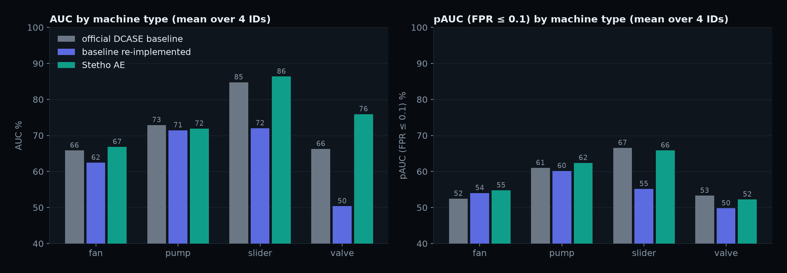</p>

Three columns, two seeds each:
- **official**: the published DCASE 2020 baseline numbers.
- **replica**: the same topology and recipe, re-implemented and trained on my smaller subset.
- **Stetho AE**: the same topology, plus per-ID feature standardisation, a cosine LR schedule, and *top-10% frame-error pooling*. A short fault, like a valve clack or a slider jerk, is not averaged away over 309 frames.

| Machine | ID | Official AUC / pAUC | Replica AUC / pAUC | **Stetho AE** AUC ± std / pAUC |
|---|---|---|---|---|
| fan | 00 | 54.4 / 49.4 | 55.9 / 49.4 | **56.2** ± 0.6 / 49.9 |
| fan | 02 | 73.4 / 52.5 | 70.2 / 57.7 | **76.7** ± 1.2 / 59.5 |
| fan | 04 | 61.6 / 55.2 | 49.6 / 48.5 | 53.4 ± 0.7 / 49.4 |
| fan | 06 | 73.9 / 52.7 | 74.0 / 60.4 | **81.1** ± 1.1 / 60.2 |
| pump | 00 | 67.2 / 56.7 | 68.8 / 57.1 | **72.0** ± 0.6 / 62.2 |
| pump | 02 | 61.5 / 58.1 | 58.7 / 54.2 | 55.3 ± 1.3 / 54.4 |
| pump | 04 | 88.3 / 67.1 | 92.9 / 74.6 | **93.5** ± 0.1 / 74.5 |
| pump | 06 | 74.5 / 62.0 | 65.5 / 54.8 | 66.9 ± 0.9 / 58.4 |
| slider | 00 | 96.2 / 81.5 | 88.5 / 63.8 | 95.9 ± 1.9 / 80.6 |
| slider | 02 | 79.0 / 63.7 | 75.7 / 52.2 | 76.2 ± 0.5 / 59.4 |
| slider | 04 | 94.3 / 72.0 | 70.5 / 55.3 | **94.4** ± 0.1 / 73.0 |
| slider | 06 | 69.6 / 49.1 | 53.3 / 49.3 | **78.9** ± 0.3 / 50.4 |
| valve | 00 | 68.8 / 51.7 | 46.7 / 50.2 | **77.0** ± 0.9 / 52.0 |
| valve | 02 | 68.2 / 51.8 | 57.3 / 49.3 | **75.9** ± 0.9 / 52.2 |
| valve | 04 | 74.3 / 61.2 | 52.7 / 50.9 | **86.1** ± 0.4 / 55.6 |
| valve | 06 | 53.9 / 48.4 | 44.9 / 48.8 | **64.7** ± 0.9 / 49.2 |
| **mean** | | **72.4 / 58.3** | **64.1 / 54.8** | **75.3 / 58.8** |

**Takeaways.** Two cheap changes add up to **+11.2 AUC over the faithful replica** on identical data. With about 4.5× less training data, the result still beats the official baseline on average (+2.8). The biggest gain is on **valves** (+25 over the replica), whose faults are short transients, which is exactly what top-k pooling targets. Pump id 02 and fan id 04 stay hard for every variant. These AUCs are far below the 0.9+ of DCASE-winning systems, which use self-supervised machine-ID classifiers. That approach is on the [roadmap](#roadmap).

<details>
<summary><b>ROC curves per machine ID</b></summary>

<p align="center">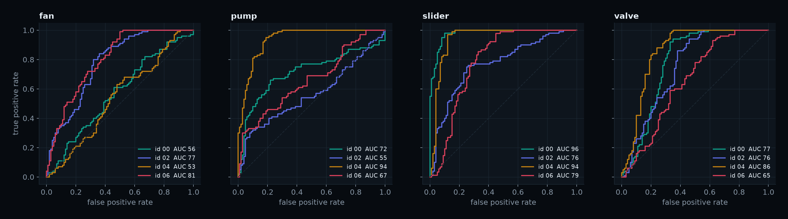</p>
</details>

### B · Full pipeline on the simulated fan rig

These checks use **12 machines the model never saw** (table fans with 3–5 blades and PC fans with 7–9 blades, 950–2200 RPM), 6 conditions, fault severities 0.6–1.0, and a fresh baseline per machine, just like a user would:

| Metric | Value |
|---|---|
| 6-class accuracy (healthy + 5 faults) | **86.1%** |
| Fault detection rate (any fault flagged) | **86.7%** |
| False-alarm rate on healthy checks | **4.2%** |
| Healthy-vs-fault AUC: autoencoder only / physics only / **fused** | 0.746 / 0.986 / **0.980** |

<p align="center">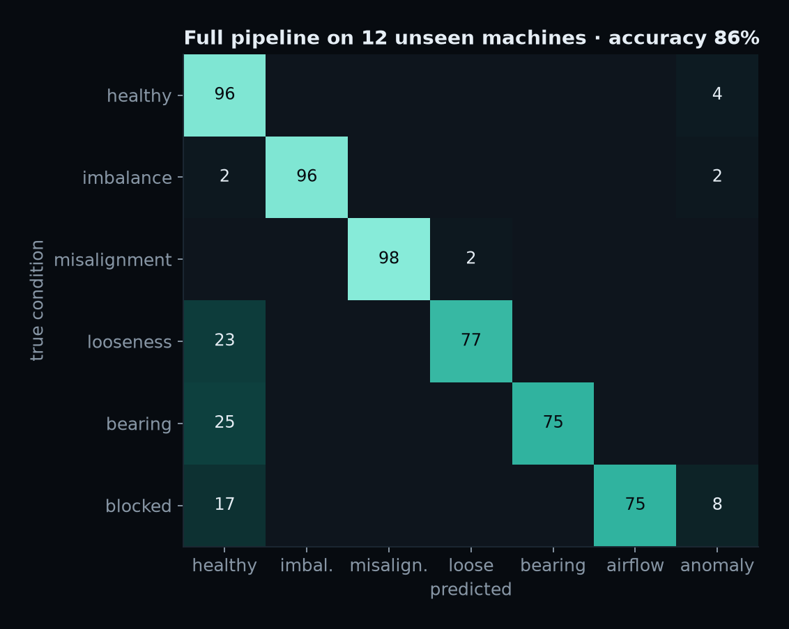</p>

The errors are honest ones. Misses happen at the weakest severity (0.6), where looseness and bearing wear still sound "healthy". The fused system almost never confuses one named fault for another.

<p align="center">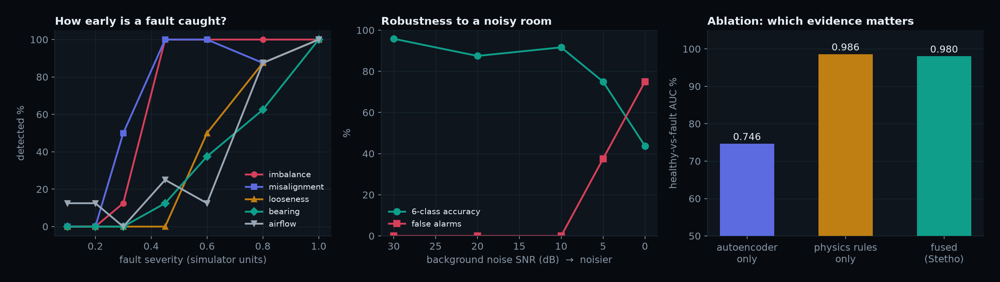</p>

- **Left: how early is a fault caught?** Imbalance and misalignment are detected from about 0.45 severity. Bearing wear and blockage need about 0.8.
- **Middle: noisy room.** With the same background noise during baseline and check, accuracy stays at 88% or more down to 10 dB SNR and collapses at 0 dB.
- **Right: ablation.** The autoencoder alone is a weak *classifier of subtle faults* (AUC 0.75). The physics rules carry the diagnosis, and fusion keeps the AE's coverage of anything the rules don't model, like an unknown new sound. The physics-only number is optimistic, because the simulator encodes the same physics (see [limits](#honest-limits)).

<p align="center">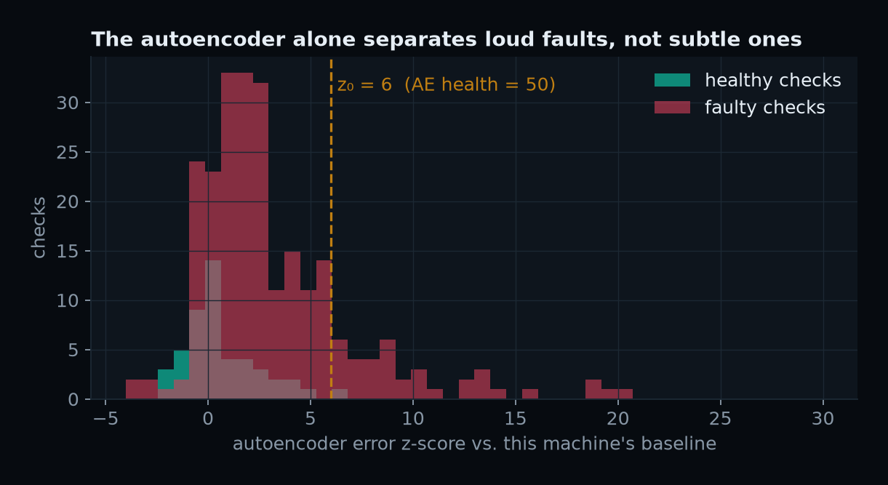</p>

**Trend tracking.** This is the "health dropped from 92 to 61 over 2 weeks" use case: a simulated fan gradually going out of balance, checked once a day. Health leaves the green band on day 8 (68, "watch"), and imbalance is named on day 9, while the fault is still at about half of its final severity:

<p align="center">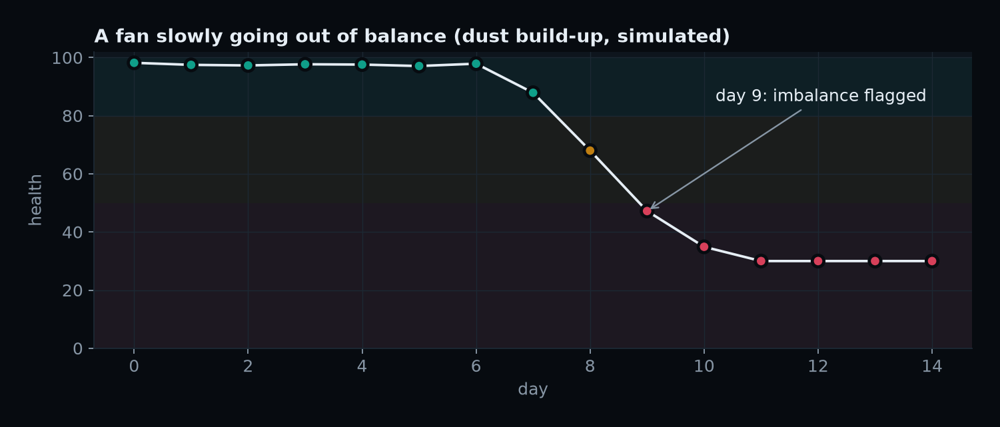</p>

### C · Speed and footprint

Measured in the browser (Chrome, 8-core Apple-silicon laptop, single-threaded WASM, median of 10 runs):

| Stage | Time |
|---|---|
| Log-mel, 313 frames × 128 bands (JS) | 14 ms |
| Autoencoder, 309 × 640 batch (ONNX Runtime Web) | 9 ms |
| Physics layer (Welch PSD, two 2¹⁸-point Hilbert transforms, envelope spectra, rules) | 422 ms |
| **Recording → verdict** | **446 ms** |
| First baseline (full shaft-speed and blade search) | 2.8 s, once per machine |

Model: **1.07 MB** (266k parameters, fp32). The whole app, including the WASM runtime, is cached by the service worker and works **fully offline**. The JS DSP reproduces the Python pipeline exactly: log-mel within 0.01 dB, and every physics measure within 0.1% ([`parity.test.js`](web/tests/parity.test.js)).

---

## Run it

```bash
# web app (demo rig works with no hardware, mic mode needs https or localhost)
cd web && npm install && npm run dev          # → http://localhost:5173

# tests: Python↔JS DSP parity + report verifier
cd web && npm test
```

```bash
# reproduce the ML side
python -m venv .venv && .venv/bin/pip install -r ml/requirements.txt
cd ml
python fetch_dcase.py            # streams a subset of DCASE/MIMII with HTTP range requests (~0.5 GB of features, no 4 GB zips)
python eval_dcase.py             # benchmark: AUC/pAUC per machine ID, 3 seeds
python train_app.py              # trains the on-device AE, evaluates the pipeline, exports web/public/models/stetho_ae.onnx
python export_parity.py          # reference features for the JS parity test
python make_figures.py           # every figure in this README
```

**Deploy:** import `web/` into Vercel (it's a static Vite build plus one optional function). To enable LLM reports, set `LLM_BASE_URL`, `LLM_API_KEY` and `LLM_MODEL`. Without them, the app keeps using the on-device template.

<details>
<summary><b>Repository layout</b></summary>

```
ml/
  stetho/features.py   log-mel front end (DCASE recipe)
  stetho/model.py      autoencoder + training + clip scoring
  stetho/physics.py    Welch PSD, Hilbert envelope, shaft-speed search, fault rules
  stetho/health.py     z-score calibration + fusion → 0–100 health
  stetho/synth.py      parametric fan simulator (6 conditions)
  fetch_dcase.py       range-request streaming of MIMII/DCASE from Zenodo
  eval_dcase.py        public benchmark
  train_app.py         on-device model + pipeline evaluation + ONNX export
  make_figures.py      README figures
web/
  src/dsp/             fft.js · mel.js · physics.js · health.js · report.js  (1:1 ports, parity-tested)
  src/ml/ae.js         ONNX Runtime Web inference
  src/audio/           raw mic capture (AudioWorklet) · demo-rig playback · WAV codec
  src/components/      Three.js waterfall · health dial · envelope plot · history
  src/store/db.js      IndexedDB: machines, baselines, checks
  api/report.js        optional LLM proxy (numbers in, text out)
  tests/               parity + verifier tests
tools/record_demo.py   drives the real app with Playwright to record the demo video
results/               metrics JSON from every experiment
```
</details>

<details>
<summary><b>Design decisions</b></summary>

- **Why an autoencoder and not a classifier?** Labelled fault recordings barely exist for any specific machine. An AE trained on healthy sound is the standard industrial approach (it is also the DCASE baseline), and it lets a user add a new machine with a single 10-second recording.
- **Why physics rules on top?** "Anomaly score 7.4" is not actionable, but "1× up 16 dB → check the blades" is. The rules also make the system *auditable*, because every verdict carries the numbers that caused it.
- **Why envelope analysis instead of the raw FFT?** Phone microphones lose almost everything below 100 Hz, where shaft orders live. Modulation survives.
- **Why on-device?** Privacy, offline factories, zero server cost, and instant results. The model is 1 MB and a check takes well under a second.
- **Why a template report by default?** It is deterministic, free, offline and verifiable. The LLM is an optional nicety, never a dependency.
</details>

---

## Honest limits

> [!WARNING]
> Stetho is a **screening tool**, not a certified condition-monitoring system.

- **Microphone ≠ accelerometer.** Airborne sound is a lossy, room-dependent proxy for vibration. Placement matters: keep the phone 20–30 cm away, at the same spot as the baseline.
- **Fault labels are validated on simulation.** The simulator encodes the same physics the rules look for, so the physics-only score is *optimistic* there. Real fans will be messier: misalignment and looseness both raise harmonics and are easy to confuse.
- **Variable-speed machines.** The rules work in shaft orders and track speed within ±8% of the baseline. A machine run at a very different speed setting needs its own baseline.
- **Noisy rooms.** With *consistent* background noise, accuracy holds down to about 10 dB SNR and then falls. A *new* noise source that appears after the baseline (a radio, a second machine) will be flagged as "abnormal", which is correct behaviour but not a machine fault.
- **Subtle faults.** Early-stage bearing wear and mild blockage are detected only past roughly 0.6–0.8 severity (see the severity curves). The AE alone separates loud faults much better than subtle ones.
- **Benchmark scope.** The public benchmark uses a fixed subset of the DCASE development set (200 training clips per ID instead of about 900, plus 100 + 100 test clips) to fit a laptop with 5 GB of free disk. The protocol is otherwise the official one.

## Roadmap

- [ ] Physical rig dataset: about 200 clips from a table fan across 4 conditions (coin on blade, loosened screw, blocked airflow, normal), recorded on 2 phones over 2 sessions, split by session
- [ ] Latency on mid-range Android and iPhone (current numbers are from a laptop browser)
- [ ] Per-machine fine-tuning of the AE's last layers on-device
- [ ] Self-supervised machine-ID classifier (the DCASE 2020 winning recipe) as a second detector
- [ ] Multi-baseline support (speed settings 1/2/3 of a fan)

## Demo

<div align="center">

A 75-second screen recording of the real app (demo-rig mode). It records a baseline, then diagnoses a normal fan, a coin on a blade, a loose screw, blocked airflow and a worn bearing, and ends on the health history.

<a href="docs/demo.mp4">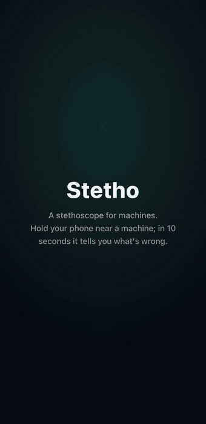</a>

**[▶ Watch the full-quality MP4](docs/demo.mp4)**

<sub>Recorded automatically by <a href="tools/record_demo.py"><code>tools/record_demo.py</code></a>, which drives the production UI with Playwright. Listening segments are sped up 2.5×.</sub>

</div>

## References

- Purohit et al., *MIMII Dataset: Sound Dataset for Malfunctioning Industrial Machine Investigation and Inspection*, DCASE 2019.
- Koizumi et al., *Description and Discussion on DCASE2020 Challenge Task 2: Unsupervised Anomalous Sound Detection for Machine Condition Monitoring*, 2020.
- Randall & Antoni, *Rolling element bearing diagnostics: a tutorial*, Mechanical Systems and Signal Processing, 2011.

<div align="center">

---

**Made by Amartya Vikram Singh** · [MIT License](LICENSE)

</div>
